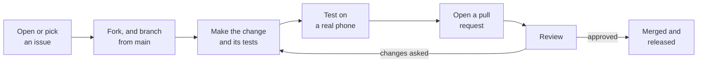

# Contributing to Eigentone

[← Back to the README](README.md)

Thanks for thinking of helping. Eigentone is free and open source, and it's better for every person who tries it, reports a problem, or sends a change.

> [!TIP]
> You don't need to write code to help, and no contribution is too small.

**On this page:** [Ways to help](#ways-to-help) · [Reporting a bug](#reporting-a-bug) · [Suggesting a feature](#suggesting-a-feature) · [Contributing code](#contributing-code) · [Translating](#translating) · [Licence](#licence)

## Ways to help

| Way to help | Code needed? | How |
|---|---|---|
| 📱 **Try it on your phone** | No | Eigentone has only been tested on three phones, and Android's audio differs from one maker to the next. Tell us how it works on yours, good or bad. |
| 🐞 **Report a bug** | No | Open an [issue](https://github.com/Dragjon/eigentone/issues), as [below](#reporting-a-bug) |
| 💡 **Suggest an idea** | No | Say what you were trying to do and what got in the way. That helps more than a finished design. |
| 🌍 **Translate the app** | A little | See [Translating](#translating) |
| 📝 **Improve the docs** | No | A clearer sentence, a missing step or a fixed typo are all welcome |
| 🛠️ **Write code** | Yes | Fixes, features, tests and tidying, as [below](#contributing-code) |

## Reporting a bug

Please include:

1. **The Eigentone version**, shown beside the name at the top of the app.
2. **Your phone and Android version**, such as "Galaxy A54, Android 16".
3. **What's playing through**: the phone speaker, wired headphones, or the Bluetooth model.
4. **What you did, what you expected, and what happened instead.** Screenshots or a short screen recording help a lot.
5. **The debug log**, if the problem is with sound or the EQ turning on: Settings → Troubleshooting has a debug console whose log you can copy into the issue.

> [!NOTE]
> Crash reports stay on the phone until you choose to share one, from the Settings tab.

## Suggesting a feature

Open an issue that describes the problem first: what you listen to, on what, and what you'd like to be able to do. Eigentone is *simple by default, powerful when needed*, so a new control may end up under Advanced controls, or as part of something that's already there.

## Contributing code

### Before you start

> [!IMPORTANT]
> For anything bigger than a small fix, please open an issue first, or comment on an existing one, so we can agree on the approach before you spend time on it.



### Setting up

[Building Eigentone](docs/BUILDING.md) covers what you need, how to build and install a debug copy on your phone, and where things are in the code. [How the sound is built](docs/HOW-IT-WORKS.md) and [Known limits](docs/KNOWN-LIMITS.md) explain the audio side.

### Making a change

1. Fork the repository and create a branch from `main` with a name that says what it's for, such as `fix-fader-labels`.
2. Make your change, keeping it focused on one thing.
3. Run the unit tests, and try the change on a real phone:

   ```powershell
   .\gradlew.bat :app:testDebugUnitTest :app:installDebug
   ```

4. Add or update tests for logic in `data/` or `dsp/`.
5. Open a pull request against `main`. Say what it changes and why, how you tested it and on which phone, and add before-and-after screenshots for anything you can see.

### Guidelines

| Area | Guideline |
|---|---|
| **Code** | Kotlin and Jetpack Compose, following the style of the code around your change |
| **Comments** | Say why, not what, in plain sentences |
| **Text people read** | Plain and short, in British English ("colour", "equaliser"), and in `app/src/main/res/values/strings_ui.xml` rather than in the code |
| **Commit messages** | A short first line saying what the change does, such as "Keep fader labels clear of the handles", with more detail below it if needed |
| **Privacy** | No analytics, ads or tracking, and no network use beyond what the user asks for. See [Privacy](docs/PRIVACY.md). |

**Interface rules Eigentone keeps.** [Design philosophies](docs/DESIGN-PHILOSOPHIES.md) explains each one and why it's there.

- [ ] Touch targets are at least 48 dp.
- [ ] Anything that acts at once can be undone.
- [ ] Unsaved changes are visible straight away.
- [ ] A control does nothing on an accidental touch.
- [ ] Every gesture has a button a screen reader can use.
- [ ] Text fits its control on a small screen and with large text.

### Before opening a pull request

- [ ] The unit tests pass.
- [ ] You've tried the change on a real phone, and say which one.
- [ ] New logic in `data/` or `dsp/` has tests.
- [ ] Anything you can see has before-and-after screenshots.

### Reviews

A maintainer will look at your pull request, may ask for changes, and will try it on a phone before merging. Releases are published on [GitHub](https://github.com/Dragjon/eigentone/releases).

## Translating

Most text is in `app/src/main/res/values/strings.xml` and `strings_ui.xml`. To add a language, copy those to `values-<code>/` and translate them. Text with values inserted, such as "Deleted Main preset", and text chosen by a condition is still in the Kotlin code, and needs moving before a translation can be complete.

> [!NOTE]
> If you'd like to translate, open an issue so we can help get the remaining text out of the code first.

## Licence

Eigentone is licensed under the [GNU General Public License v3.0](LICENSE). By contributing, you agree that your contribution is shared under the same licence.

## Be kind

Be welcoming and patient, especially with people new to open source or writing in a second language. Disagree about ideas, never about people.
