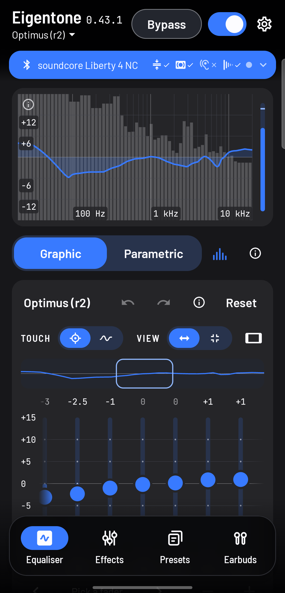
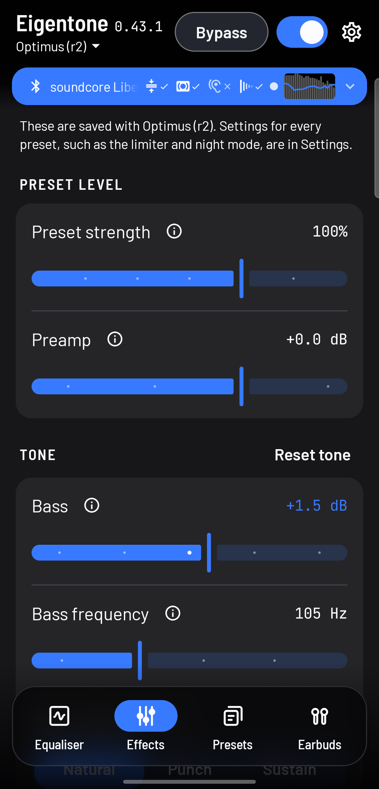
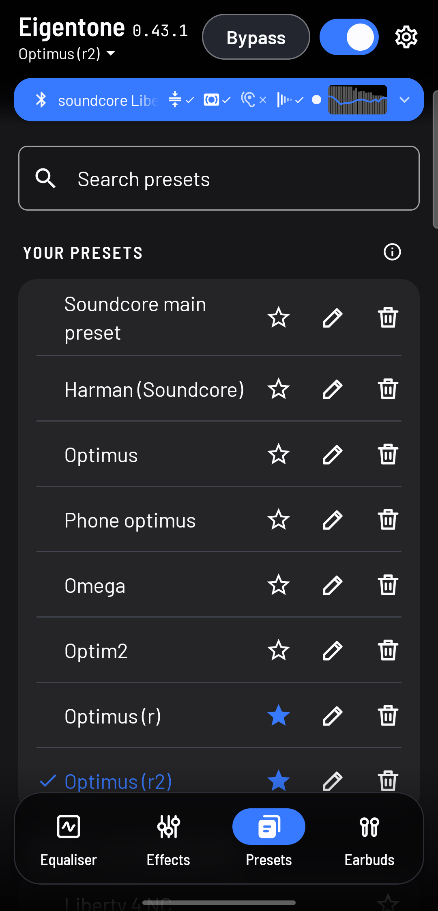
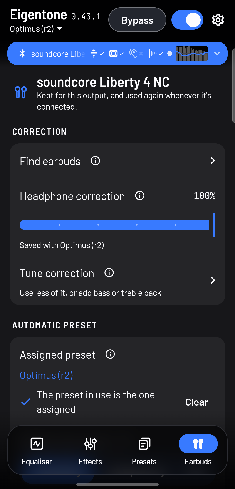
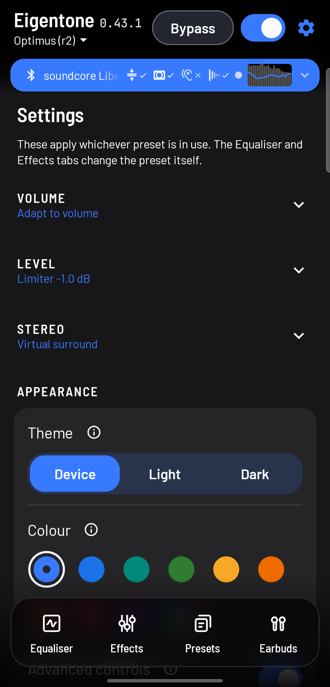

  

<h1 align="center">Eigentone</h1>

  <b>A free, open-source equaliser for Android that tunes every app to your headphones and your ears.</b> 
  No root. No ads. No account. No tracking.

  
  
  
  

  
  
  
  

  
  
  
  
  

> *Eigentones are the natural resonant tones of an enclosed space. "Eigen" is German for "own", so the name reads as "your own tone".*

Eigentone sits behind Spotify, YouTube and most other apps, and shapes their sound system-wide using Android's `DynamicsProcessing` effect. Connect your headphones and it offers a correction measured for them. Take the short hearing check and it fits the sound to each of your ears. Everything else, from a 31-band graphic EQ to a multiband compressor, is there when you want it and out of the way when you don't.

We take inspiration from KDE Plasma's motto: **simple by default, powerful when needed**.

## Why Eigentone

| Reason | What it means |
|---|---|
| **Everything is free** | No paid tier and nothing locked. Reverb, surround and the compressor are free like the rest. |
| **It's open source** | GPL v3, so anyone can check what it does with their audio, build it themselves, or improve it. |
| **It fits you, not just your headphones** | AutoEq corrections fix the headphones. The hearing check, a separate EQ for each ear and *Find my sound* fit the sound to you. |
| **It's honest about what it changes** | Comparisons and Bypass are loudness-matched, so louder never wins by accident, and it warns when a setting could clip. |

## Highlights

| Shape the sound | Fit it to you | Let it run itself |
|---|---|---|
| Graphic EQ with 10, 15 or 31 faders | Headphone correction from AutoEq | Presets that load per output, noise mode and app |
| Parametric EQ, up to 20 filters | Hearing check, with an EQ for each ear | Night mode on a schedule |
| 350-shape library | *Find my sound*, a level-matched A/B test | Quick Settings tile and widget |
| Compressor, dynamic EQ, limiter | Peak finder and frequency sweep | Undo, redo, Save and Discard |

Every feature is listed in [Features](docs/FEATURES.md), and [Eigentone and Wavelet](docs/COMPARISON.md) compares it with the best-known alternative.

## Get started

1. **Download** the latest APK from [Releases](https://github.com/Dragjon/eigentone/releases) and open it on your phone. It needs Android 11 or newer, and no root.
2. **Follow the short welcome**, then switch Eigentone on with the switch at the top.
3. **Connect your headphones.** Eigentone offers a correction for them, or find one on the device tab.

> [!NOTE]
> Eigentone is a pre-release, tested on three phones so far. If something doesn't work on yours, please [open an issue](https://github.com/Dragjon/eigentone/issues). [Installing and updating](docs/INSTALL.md) has the details.

## On Windows

Eigentone is on Windows 11 too, as [Eigentone for Windows](https://github.com/Dragjon/eigentone-windows). It has the same presets, curves and tools, laid out as an audio studio for a bigger screen, and it shapes every app through a plug-in in Windows' own audio engine. It adds a tray icon, shortcuts that work from any app, and presets per app.

Download the installer from its [releases](https://github.com/Dragjon/eigentone-windows/releases). It's an early pre-release too. Presets move between your phone and your PC with share codes and backups, which both versions read.

## Documentation

| For listeners | What's inside |
|---|---|
| [Features](docs/FEATURES.md) | Everything Eigentone does, with screenshots |
| [Eigentone and Wavelet](docs/COMPARISON.md) | A side-by-side comparison |
| [Installing and updating](docs/INSTALL.md) | Install, update, and the phones it's been tested on |
| [Privacy](docs/PRIVACY.md) | What each permission is for, and what's never collected |
| [Known limits](docs/KNOWN-LIMITS.md) | What Android doesn't allow without root, and the workarounds |
| [Changelog](CHANGELOG.md) | What changed in each release |

| For contributors | What's inside |
|---|---|
| [Contributing](CONTRIBUTING.md) | How to report bugs, suggest ideas, translate, or send code |
| [Building Eigentone](docs/BUILDING.md) | Build from source, and where things are in the code |
| [How the sound is built](docs/HOW-IT-WORKS.md) | The audio chain, and the decisions behind it |
| [Design philosophies](docs/DESIGN-PHILOSOPHIES.md) | The interaction rules the app follows, and why |

## Contributing

Contributions of every size are welcome, from testing on your phone and reporting bugs to translations and code. Start with [Contributing](CONTRIBUTING.md), or open an [issue](https://github.com/Dragjon/eigentone/issues).

## Privacy

No ads, no analytics, no account, and nothing about you is sent anywhere. What each permission is for is in [Privacy](docs/PRIVACY.md).

## License

Eigentone is free software under the [GNU General Public License v3.0](LICENSE). Third-party material keeps its own terms, listed in [THIRD_PARTY_NOTICES.txt](THIRD_PARTY_NOTICES.txt).

## Credits

HUGE THANKS to the goated [Natcuber](https://github.com/Natcuber) for suggesting many of the improvements in Eigentone and testing the app extensively!!! 

| Material | Source |
|---|---|
| **Fonts** | Barlow and JetBrains Mono, under the SIL Open Font License 1.1 |
| **Headphone data** | Headphone corrections, target curves and the built-in presets made for particular headphones use [AutoEq](https://github.com/jaakkopasanen/AutoEq) results and targets (MIT License). Presets made for one pair of headphones only appear while those headphones are connected. |
| **Research** | Shapes and targets use figures from ISO 226:2003 (equal-loudness contours), ANSI S3.5 band weights, and Sean Olive and colleagues' Harman listening research, including "The Perception and Measurement of Headphone Sound Quality" (Acoustics Today, 2022). |
