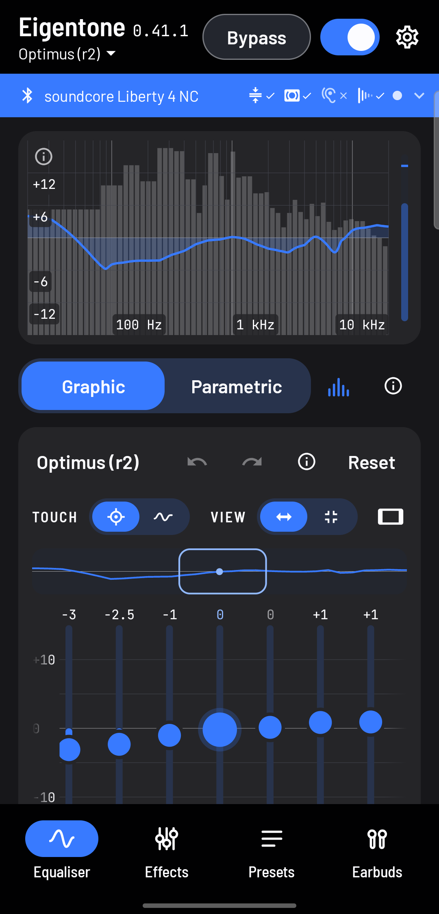
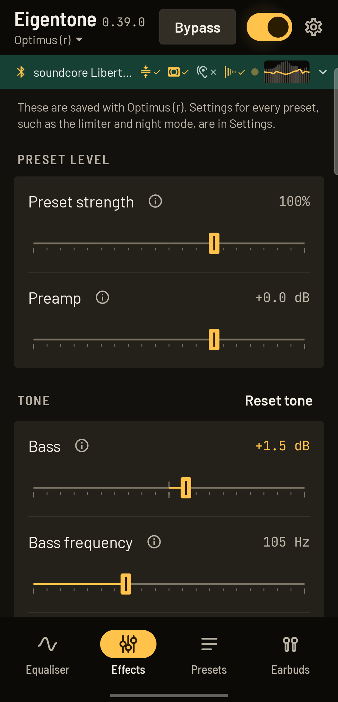
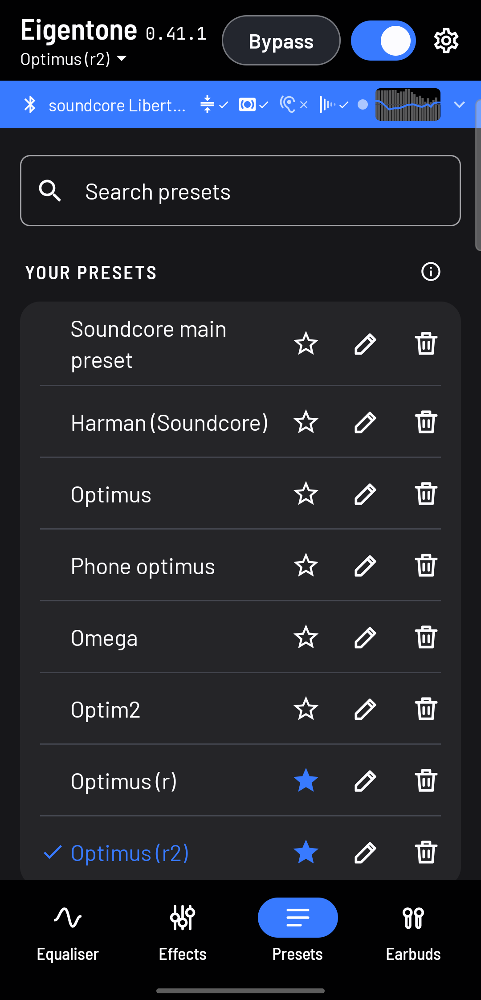
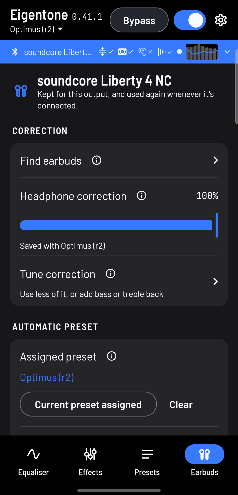
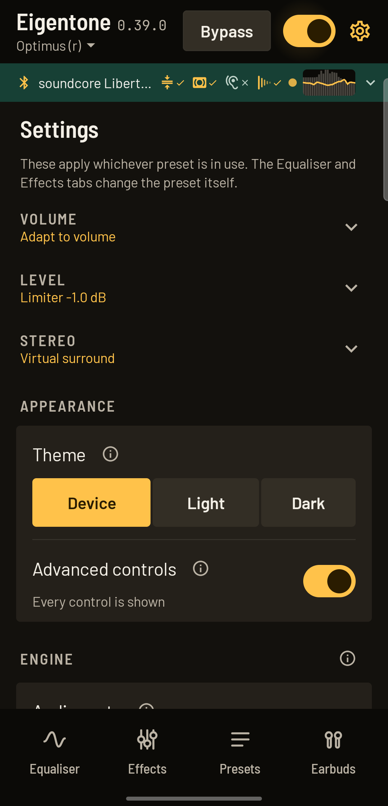

<p align="center">
  
</p>

<h1 align="center">Eigentone</h1>

<p align="center">
  <b>A free, open-source equaliser for Android that tunes every app to your headphones and your ears.</b><br>
  No root. No ads. No account. No tracking.
</p>

<p align="center">
  <a href="https://github.com/Dragjon/eigentone/releases"></a>
  <a href="LICENSE"></a>
  
  
</p>

<p align="center">
  
  
  
  
  
</p>

*Eigentones are the natural resonant tones of an enclosed space. "Eigen" is German for "own", so the name reads as "your own tone".*

Eigentone sits behind Spotify, YouTube and most other apps, and shapes their sound system-wide using Android's `DynamicsProcessing` effect. Connect your headphones and it offers a correction measured for them. Take the short hearing check and it fits the sound to each of your ears. Everything else, from a 31-band graphic EQ to a multiband compressor, is there when you want it and out of the way when you don't: **simple by default, powerful when needed**.

## Why Eigentone

- **Everything is free.** There's no paid tier and nothing locked. Reverb, surround and the compressor are free like the rest.
- **It's open source.** The code is GPL v3, so anyone can check what it does with their audio, build it themselves, or improve it.
- **It fits you, not just your headphones.** AutoEq corrections fix the headphones. The hearing check, a separate EQ for each ear, and *Find my sound*, a level-matched A/B listening test, fit the sound to you.
- **It's honest about what it changes.** Comparisons and Bypass are loudness-matched, so louder never wins by accident, and it warns when a setting could clip.

## Eigentone and Wavelet

[Wavelet](https://play.google.com/store/apps/details?id=com.pittvandewitt.wavelet) is the best-known system-wide EQ for Android, and it's good. Both work system-wide without root and both use AutoEq's measurements. Eigentone goes further on control, on fitting the sound to you, and on openness.

| | Eigentone | Wavelet |
|---|---|---|
| Price | Free, everything included | Free, with reverb, virtualizer and bass tuner as a paid upgrade<sup>[1]</sup> |
| Source code | Open, GPL v3 | Not published |
| Graphic EQ | 10, 15 or 31 bands, drawn freely or by fader | 9 bands<sup>[2]</sup> |
| Parametric EQ | Up to 20 filters | Not in its feature list |
| Headphone correction | AutoEq, with a strength control, a tuner to add bass or treble back, and reviewer measurements compared by ear | AutoEq, 5,000+ profiles bundled<sup>[3]</sup> |
| Fit to your ears | Hearing check, a separate EQ for each ear, and a guided A/B test that finds your preferred sound | Not in its feature list |
| Dynamics | Multiband compressor, dynamic EQ (Clarity), leveller, night mode on a schedule, limiter | Limiter with automatic preamp<sup>[3]</sup> |
| Loudness compensation | ISO 226 equal-loudness, with a usual volume per pair of headphones | ISO 226 equal-loudness<sup>[3]</sup> |
| Automatic presets | Per output, per earbud noise mode and per app | A profile for the connected headphones |
| Finding problems by ear | Peak finder, frequency sweep and a blind A/B comparison | Not in its feature list |
| Curves and files | 350-shape library, ParametricEQ and GraphicEQ import, GraphicEQ export, share codes | Not in its feature list |
| Ads and tracking | None. No analytics, no account | No ads<sup>[4]</sup> |
| Availability | GitHub releases, Android 13 and newer, tested on one phone so far | Google Play, 5.5 million+ installs<sup>[4]</sup> |

Where Wavelet is ahead: it's on Google Play, it has years of testing across millions of phones, and its AutoEq database works offline, where Eigentone downloads a profile when you ask for one. If you want the simplest one-tap correction on a phone Eigentone hasn't been tested on, Wavelet is a safe choice. If you want to shape the sound in detail, fit it to your own ears, or know exactly what the app does, that's what Eigentone is for.

<sub>Wavelet details as of November 2026, from its listings and coverage, and they may have changed since. [1] [XDA Developers](https://www.xda-developers.com/make-your-headphones-sound-better-automatic-eq-wavelet/) lists reverberation, virtualizer and bass tuner as an in-app purchase. [2] XDA Developers and [Softpedia](https://mobile.softpedia.com/apk/wavelet/) describe a 9-band graphic EQ. [3] Its [Google Play listing](https://play.google.com/store/apps/details?id=com.pittvandewitt.wavelet) and [SourceForge listing](https://sourceforge.net/app/wavelet-headphone-specific-eq/). [4] [AppGoblin](https://appgoblin.info/apps/com.pittvandewitt.wavelet). "Not in its feature list" means we couldn't find it described, not that it's certainly missing. Corrections are welcome as an issue.</sub>

## Features

- **Graphic EQ** with 10, 15 or 31 faders. Drag them or draw a curve with one sweep.
- **Parametric EQ** with up to 20 filters.
- **Shape library** of 350 curves, searchable by genre, instrument, situation or problem. Some are worked out from published research, and say so. Hear each on your music before keeping it, and layer them.
- **Headphone targets**: move a measured correction to Harman, more or less bass, no bass lift, or the diffuse-field reference, worked out from what that correction actually aims for.
- **Your own shapes**, typed in from any other app's EQ.
- **Headphone correction** from AutoEq's published measurements, with a strength control, and a way to compare reviewers' measurements by ear. Eigentone offers one when headphones connect.
- **Compare two sounds**, switching instantly at matched loudness, with an optional blind test.
- **Find my sound**, a guided A/B listening test that has to beat your current sound before you keep it.
- **Hearing check** that builds a gentle curve for how you hear, with a separate EQ for each ear if they differ, saved per pair of headphones and drawn as a curve for each ear. It isn't a medical test.
- **EQ files**: import ParametricEQ and GraphicEQ files, and export any sound as a 127-point GraphicEQ file. Imported GraphicEQ curves keep every point rather than being rounded to faders.
- **Find peaks for me**, a guided listening test that finds peaks and dips in your headphones and suggests narrow filters.
- **Frequency sweep**, a climbing tone that lets you mark peaks and dips by ear and turns them into narrow filters.
- **Presets** that load automatically per output, per earbud noise mode and per app.
- **Clarity** (dynamic EQ), with a harshness tamer and a boom tamer that only act while those ranges get loud.
- **Multiband compressor**, free and fully adjustable and saved per preset, with three bands, adjustable crossovers, a live response curve and starting styles.
- **Volume leveller**, night mode with a schedule, equal-loudness compensation from the ISO 226 contours, with a usual volume per pair of headphones, limiter, balance, stereo width, virtual surround, and reverb on apps that announce their audio.
- **Simple by default, powerful when needed**: a short welcome and a tour of the main screen for new users, and an Advanced controls switch that shows every setting. With it off, anything you've changed still stays in view.
- **Light and dark themes**, following your phone by default.
- **Undo and redo**, a saved-curve overlay while editing and a warning when settings could clip.
- **Preset search and folders**, app icon shortcuts to your favourites, and a tuner that adds bass or treble back to a correction.
- **Share codes**, backups, a Quick Settings tile and a home-screen widget.

## Privacy

Eigentone has no ads, analytics or account, and it sends nothing about you anywhere.

| Permission | Why | When |
|---|---|---|
| Internet | Downloads headphone profiles from AutoEq's public GitHub repository | Only when you ask for a correction |
| Microphone | Android requires it for the spectrum analyser, which reads the level of playing audio and doesn't record the microphone | Only if you turn the analyser on |
| Notification access | The only way Android reveals which app is playing, for per-app presets. Notifications are ignored | Only if you grant it |
| Notifications, background and start at boot | Keep the EQ running, with a visible notification | While Eigentone is on |

Crash reports stay on the phone. You choose whether to share one from the Settings tab.

## Install

Download the APK from [Releases](https://github.com/Dragjon/eigentone/releases), and open it on the phone. Eigentone is a pre-release, and has only been tested on a Galaxy A54 running Android 16. If something goes wrong on your phone, Settings, Troubleshooting has a debug console whose log you can attach to an [issue](https://github.com/Dragjon/eigentone/issues). Or install with USB debugging:

```powershell
& "$env:LOCALAPPDATA\Android\Sdk\platform-tools\adb.exe" install -r Eigentone-0.34.0.apk
```

## Build

```powershell
$env:JAVA_HOME = "C:\Program Files\Android\Android Studio\jbr"
.\gradlew.bat :app:testDebugUnitTest :app:assembleRelease
```

The APK is written to `app\build\outputs\apk\release\app-release.apk`.

Back up `eigentone-release.jks` and `keystore.properties`. They are excluded from version control, and Android refuses updates signed with a different key, so losing them means uninstalling (and losing presets) to update.

## Translating

Most text is in `app/src/main/res/values/strings.xml` and `strings_ui.xml`. To add a language, copy those to `values-<code>/` and translate them. Text with values inserted, such as "Deleted Main preset", and text chosen by a condition is still in the Kotlin code, and needs moving before a translation can be complete.

## Layout

Everything lives under `app/src/main/java/io/github/dragjon/eigentone/`:

- `dsp/`: filter maths, the curve-to-band mapping, the AutoEq parser and the shape library. Pure Kotlin with unit tests.
- `engine/`: the `DynamicsProcessing` wrapper, foreground service, tile, widget, hearing check tones and playing-app detection.
- `data/`: saved state, presets, undo, share codes and the listening test logic.
- `ui/`: the Compose interface.

The Kotlin package and the application ID are both `io.github.dragjon.eigentone`.

**Updating from 0.33.0 or earlier:** 0.34.0 renames the app's internal classes, so Android forgets a few things tied to the old names. Add the Quick Settings tile and home-screen widget again, grant notification access again if you use per-app presets, and re-pin any preset shortcuts on your home screen. Share codes made before 0.34.0 no longer work, so share the preset again for a new code. Your presets and settings are kept.

## License

Eigentone is free software under the [GNU General Public License v3.0](LICENSE). Third-party material keeps its own terms, listed in [THIRD_PARTY_NOTICES.txt](THIRD_PARTY_NOTICES.txt).

## Credits

HUGE THANKS to the goated [Natcuber](https://github.com/Natcuber) for suggesting many of the improvements in Eigentone and testing the app extensively!!! 

Barlow and JetBrains Mono are used under the SIL Open Font License 1.1.

The Liberty 4 NC presets, headphone corrections and target curves use [AutoEq](https://github.com/jaakkopasanen/AutoEq) results and targets (MIT License). The Liberty presets only appear while those earbuds are connected.

Research shapes and targets use figures from ISO 226:2003 (equal-loudness contours), ANSI S3.5 band weights, and Sean Olive and colleagues' Harman listening research, including "The Perception and Measurement of Headphone Sound Quality" (Acoustics Today, 2022).

## How the sound is built

A preset holds a whole sound: parametric filters, graphic EQ, tone, surround, compressor, strength, correction amount and preamp. Balance, ear correction, night mode, the leveller, loudness compensation and limiter settings stay global.

Preset changes morph rather than jump (`data/GainRamp.kt`). Bands and the input level move together in steps of at most 4 dB, so if the old and new sounds are each safe from clipping, so is every step between them. The compressor fades along with it, in level, ratio and crossovers. Bypass, comparisons and the hearing check still switch at once.

Loudness matching for comparisons and Bypass includes an estimate of what the compressor does at a typical music level. It's close rather than exact, because real music varies.

The phone has one compressor, so night mode, manual settings and the leveller share it, in that order of priority (`data/Dynamics.kt`).

The graphic EQ defines its curve directly from the faders rather than using overlapping bell filters. Bells of every width measured strayed by up to 3.3 dB between faders. This works because the audio engine takes a curve sampled on 128 bands.

The **shape library** (`dsp/ShapeLibrary.kt`, `dsp/ShapeData.kt`) has 350 graphic EQ curves: 13 worked out from published data, 245 hand-written across problems, music, instruments, speech and media, situations, gear and character, plus 92 generated building blocks. They can be searched and filtered by category, or by traits calculated from each curve. Shapes with a source come from published data. The rest are designed starting points, not measurements, and they don't reproduce any artist's or manufacturer's sound. Shapes less than a useful difference apart were merged, and their names still find them in search. Genre shapes stay within 4 dB, because listening tests found preferences move only about 1 dB between genres, and the genre presets in Android and VLC disagree with each other.

**Find my sound** narrows bass, vocals, treble and space through level-matched A/B choices. Its ranges follow Harman's published headphone preference research. It finds a preference for this music and these headphones, not an objectively best sound.

The **hearing check** finds a threshold per frequency and ear with a "down 10, up 5" method, capped at -15 dBFS. Levels are relative to the phone's volume, so only the differences between them are used, and the curve corrects half of those.

**Ear correction** uses the same results, which are always drawn as a curve for each ear. It's recommended when the ears differ by 10 dB or more at any frequency, because the check moves in 5 dB steps, and it's available below that as a choice. It adds a separate curve to each audio channel that closes half of the gap. Both ears share one input level, because separate levels would shift the balance across every frequency. It stays on across presets, but a check also measures the headphones, so each output keeps its own correction and latest results, and it turns on when that output connects. The phone speaker never gets one, because it can't reach each ear separately.

## Known limits

- **EQ in the headphones adds to Eigentone**, because it runs on the headphones themselves. Eigentone reminds you to set it flat, and it can't read or change it.
- **Stereo width** (`data/StereoWidth.kt`) leans frequency ranges left and right using a separate EQ per channel, cutting the side a range leans away from rather than boosting the other, so it never lowers the overall volume. It's subtle, because Android doesn't let an app mix one channel into the other, so it can't do crossfeed or real surround.
- **Android has no full replacement for `Virtualizer`.** It's deprecated in favour of `Spatializer`, but that only describes an app's own playback, and turning it on requires a system permission. It remains as an opt-in, forced to binaural mode, and stereo width takes over if a phone refuses it. It's audibly stronger, but stereo width is the default because it sounded better in listening tests on a Galaxy A54. It has no head tracking, and on a Galaxy A54 it reads `mode=0` while audibly working.
- **Reverb only reaches apps that announce their audio.** On session 0 the public API only provides an auxiliary reverb, which receives no audio, so a reverb for all sound isn't possible without root. `PresetReverb` on an app's own announced session does give the working insert version, and that runs beside the global EQ. It uses `EnvironmentalReverb`, because `PresetReverb`'s fixed levels leave Large hall's echo about 38 dB below the music. The Space section on the Effects tab names the apps it reaches.
- **Noise-mode profiles** are chosen by hand, because Android can't read the earbuds' mode.
- **Session 0 is deprecated** by Android and varies by phone. Eigentone falls back to per-app mode, and the Settings tab shows what the phone accepted.

## Shelved: Studio mode

Playback capture plus custom DSP (convolution, crossfeed). `capturelab/` holds the experiment. On a Galaxy A54 running Android 16, it worked without root by muting the music stream and playing through the alarm stream to a preferred device, but:

- Spotify cannot be captured, and it is the main listening app.
- Volume buttons unmute the music stream.
- The small test buffer stuttered, and the estimated delay was 140-340 ms before Bluetooth.
