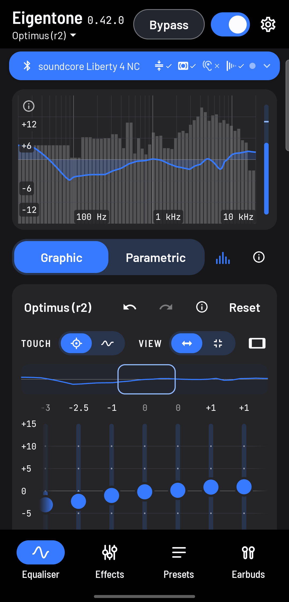
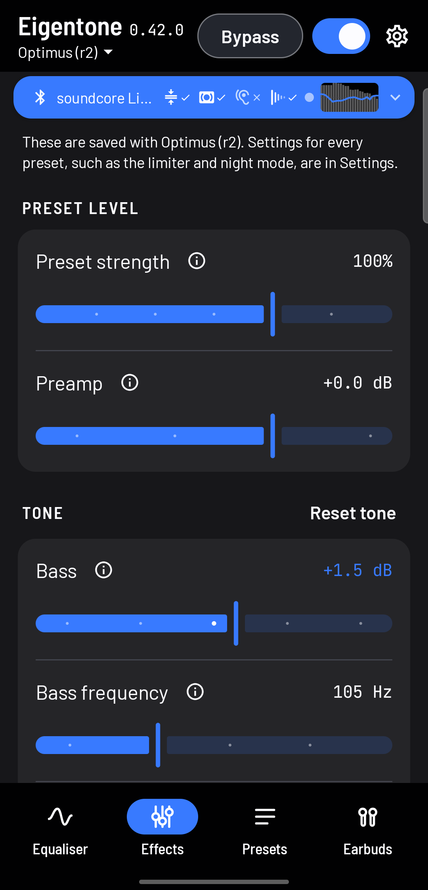
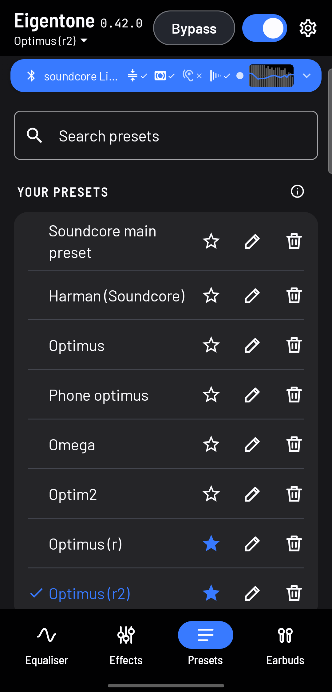
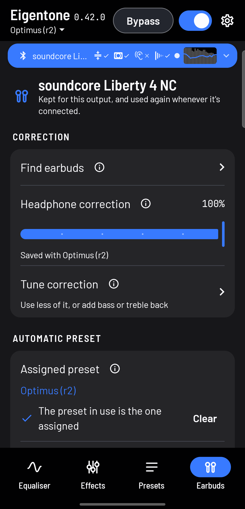
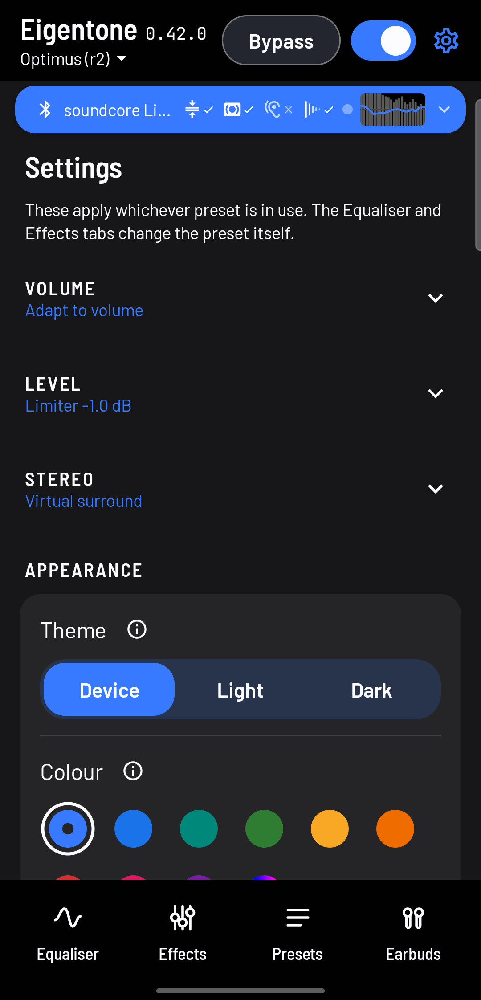

  

<h1 align="center">Eigentone</h1>

  <b>A free, open-source equaliser for Android that tunes every app to your headphones and your ears.</b> 
  No root. No ads. No account. No tracking.

  
  
  
  

  
  
  
  

  
  
  
  
  

*Eigentones are the natural resonant tones of an enclosed space. "Eigen" is German for "own", so the name reads as "your own tone".*

Eigentone sits behind Spotify, YouTube and most other apps, and shapes their sound system-wide using Android's `DynamicsProcessing` effect. Connect your headphones and it offers a correction measured for them. Take the short hearing check and it fits the sound to each of your ears. Everything else, from a 31-band graphic EQ to a multiband compressor, is there when you want it and out of the way when you don't. We take inspiration from KDE Plasma's motto: **simple by default, powerful when needed**.

## Why Eigentone

- **Everything is free.** There's no paid tier and nothing locked. Reverb, surround and the compressor are free like the rest.
- **It's open source.** The code is GPL v3, so anyone can check what it does with their audio, build it themselves, or improve it.
- **It fits you, not just your headphones.** AutoEq corrections fix the headphones. The hearing check, a separate EQ for each ear, and *Find my sound*, a level-matched A/B listening test, fit the sound to you.
- **It's honest about what it changes.** Comparisons and Bypass are loudness-matched, so louder never wins by accident, and it warns when a setting could clip.

## Highlights

- **Graphic EQ** with 10, 15 or 31 faders, and a **parametric EQ** with up to 20 filters, including dynamic ones.
- **Headphone correction** from AutoEq's measurements, offered when your headphones connect.
- **Fits your ears**: a hearing check with a separate EQ for each ear, and *Find my sound*, a level-matched A/B listening test.
- **350-shape library**, EQ file import and export, and share codes.
- **Presets that load by themselves** for each output, earbud noise mode and app.
- **Multiband compressor, dynamic EQ, leveller, night mode, limiter**, surround and reverb, all free.
- **Your colours and your size**: Material You on every Android version, larger text and higher contrast.

The full list is in [Features](docs/FEATURES.md), and how it stacks up against the best-known alternative is in [Eigentone and Wavelet](docs/COMPARISON.md).

## Install

Download the APK from [Releases](https://github.com/Dragjon/eigentone/releases) and open it on your phone. It needs Android 11 or newer and no root. Eigentone is a pre-release, tested on three phones so far, so reports from yours are very welcome.

[Installing and updating](docs/INSTALL.md) has the details, and what changed in each release is in the [changelog](CHANGELOG.md).

## Documentation

| | |
|---|---|
| [Features](docs/FEATURES.md) | Everything Eigentone does |
| [Eigentone and Wavelet](docs/COMPARISON.md) | A side-by-side comparison |
| [Privacy](docs/PRIVACY.md) | What each permission is for, and what's never collected |
| [Installing and updating](docs/INSTALL.md) | Install, update, and the phones it's been tested on |
| [How the sound is built](docs/HOW-IT-WORKS.md) | The audio decisions behind the app |
| [Known limits](docs/KNOWN-LIMITS.md) | What Android doesn't allow without root, and the workarounds |
| [Building Eigentone](docs/BUILDING.md) | Build from source, and where things are in the code |
| [Contributing](CONTRIBUTING.md) | How to report bugs, suggest ideas, translate, or send code |
| [Design philosophies](docs/DESIGN-PHILOSOPHIES.md) | The interaction rules the app follows, and why |
| [Changelog](CHANGELOG.md) | What changed in each release |

## Contributing

Contributions of every size are welcome, from testing on your phone and reporting bugs to translations and code. Start with [Contributing](CONTRIBUTING.md), or open an [issue](https://github.com/Dragjon/eigentone/issues).

## Privacy

No ads, no analytics, no account, and nothing about you is sent anywhere. Each permission and why it's asked for is in [Privacy](docs/PRIVACY.md).

## License

Eigentone is free software under the [GNU General Public License v3.0](LICENSE). Third-party material keeps its own terms, listed in [THIRD_PARTY_NOTICES.txt](THIRD_PARTY_NOTICES.txt).

## Credits

HUGE THANKS to the goated [Natcuber](https://github.com/Natcuber) for suggesting many of the improvements in Eigentone and testing the app extensively!!! 

Barlow and JetBrains Mono are used under the SIL Open Font License 1.1.

The Liberty 4 NC presets, headphone corrections and target curves use [AutoEq](https://github.com/jaakkopasanen/AutoEq) results and targets (MIT License). The Liberty presets only appear while those earbuds are connected.

Research shapes and targets use figures from ISO 226:2003 (equal-loudness contours), ANSI S3.5 band weights, and Sean Olive and colleagues' Harman listening research, including "The Perception and Measurement of Headphone Sound Quality" (Acoustics Today, 2022).
