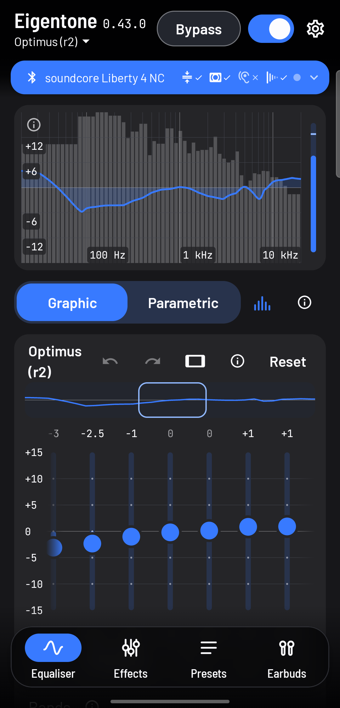
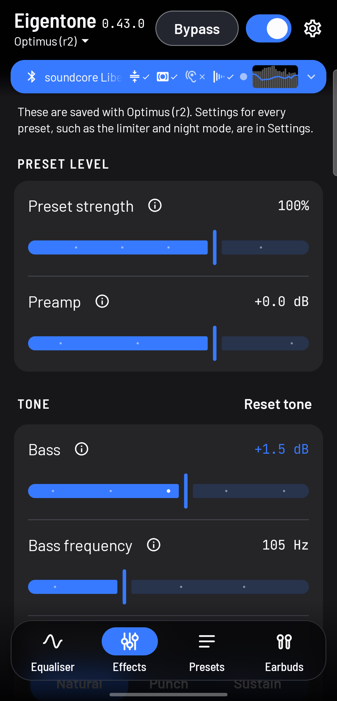
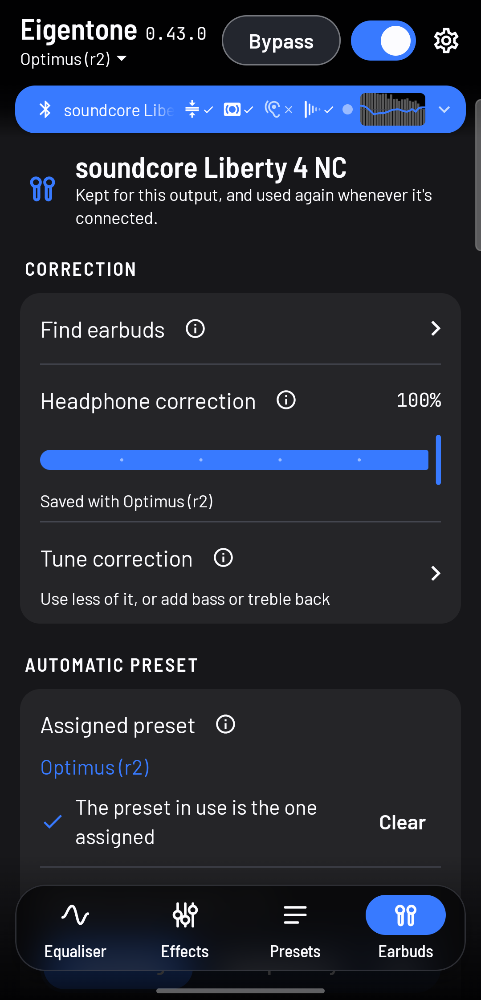

# Features

[← Back to the README](../README.md)

Everything Eigentone does, grouped by what you'd use it for.

> [!TIP]
> Most of this is tucked away until you want it. With **Advanced controls** off, the app shows the essentials, and anything you've changed always stays in view. Switch it on under Settings → Appearance to see every control.

**On this page:** [Shape the sound](#shape-the-sound) · [Fit it to you](#fit-it-to-your-headphones-and-your-ears) · [Find problems by ear](#find-problems-by-ear) · [Dynamics and space](#dynamics-and-space) · [Presets and automation](#presets-and-automation) · [Using the app](#using-the-app)

  
  
  

## Shape the sound

| Feature | What it does |
|---|---|
| **Graphic EQ** | 10, 15 or 31 faders. Drag them one at a time, or draw a whole curve in one sweep. The faders show the whole sound, the preset's own curve plus your change, so each one reads the real dB at its band. |
| **Parametric EQ** | Up to 20 filters: bell, low and high shelf, tilt, notch, band pass, and high and low pass with a slope from 6 to 48 dB per octave. Each filter can shape both channels or just the left or right. |
| **Dynamic filters** | Bells and shelves can turn their range down only while it gets loud, like a compressor for just that part of the sound. |
| **Shape library** | 350 curves, searchable by genre, instrument, situation or problem. Some are worked out from published research, and say so. Hear each on your music before keeping it, and layer them. |
| **Your own shapes** | Type in a curve from any other app's EQ. |
| **Tone** | Bass, vocals and treble, with a bass frequency and character (natural, punch or sustain). |
| **EQ files** | Import ParametricEQ and GraphicEQ files, and export any sound as a 127-point GraphicEQ file. Imported GraphicEQ curves keep every point rather than being rounded to faders. |

## Fit it to your headphones and your ears

| Feature | What it does |
|---|---|
| **Headphone correction** | From AutoEq's published measurements, with a strength control. Eigentone offers one when headphones connect. |
| **Compare measurements** | Hear different reviewers' measurements of your headphones, and keep the one you prefer. |
| **Correction tuner** | Use less of a correction, or add some bass or treble back. |
| **Headphone targets** | Move a correction to Harman, more or less bass, no bass lift, or the diffuse-field reference, worked out from what that correction actually aims for. |
| **Hearing check** | Builds a gentle curve for how you hear, with a separate EQ for each ear if they differ, saved per pair of headphones. |
| **Find my sound** | A guided A/B listening test that narrows down bass, vocals, treble and space. The result has to beat your current sound before you keep it. |
| **Refine my sound** | Fine-tunes your current sound by asking which of two versions you prefer, and stops once it's sure. |
| **Compare two sounds** | Switch instantly between two presets at matched loudness, with an optional blind test. |
| **Compare curves** | Draw two presets on one graph, and read in plain words where they differ. |

> [!NOTE]
> The hearing check isn't a medical test. It only measures differences between frequencies and ears, relative to your phone's volume.

## Find problems by ear

| Feature | What it does |
|---|---|
| **Find peaks for me** | A guided listening test that finds peaks and dips in your headphones and suggests narrow filters to fix them. |
| **Frequency sweep** | A climbing tone that lets you mark peaks and dips by ear, and turns them into narrow filters. |
| **Measure a speaker** | For a Bluetooth speaker or a car: tones played and heard from three spots where you sit become a gentle correction that loads whenever it connects. A USB measurement microphone is used when one is plugged in. |

## Dynamics and space

| Feature | What it does |
|---|---|
| **Clarity** | A dynamic EQ, with a harshness tamer and a boom tamer that only act while those ranges get loud. |
| **Multiband compressor** | Free, fully adjustable and saved per preset, with three bands, adjustable crossovers, a live response curve and starting styles. |
| **Volume leveller** | Slowly evens out loud and quiet passages, which helps when apps and tracks differ in level. |
| **Night mode** | Keeps loud moments down for quiet listening, on a schedule if you like. |
| **Quiet listening** | Equal-loudness compensation from the ISO 226 contours, which adds back the bass and treble you stop hearing at low volume, with a usual volume per pair of headphones. |
| **Limiter** | Catches peaks before they clip, with adjustable timing under Advanced controls. |
| **Stereo** | Balance, stereo width and virtual surround. |
| **Reverb** | Small, medium and large rooms, medium and large halls, and a plate, on apps that announce their audio. |

## Presets and automation

| Feature | What it does |
|---|---|
| **Automatic presets** | Load a preset per output, per earbud noise mode and per app. |
| **A tab for what's playing** | Named and drawn for it: Phone, Headphones, Earbuds, Speaker or Car, with an animation when the device changes. Its page offers what suits that device. |
| **Preset search and folders** | Find and organise your presets, with favourites starred. |
| **Shortcuts** | App icon shortcuts to your favourite presets, a Quick Settings tile and a home-screen widget. |
| **Share codes and backups** | Send a preset as a short code, or back up your presets to a file. |

## Using the app

| Feature | What it does |
|---|---|
| **Simple by default** | A short welcome and a tour of the main screen for new users, and an Advanced controls switch that shows every setting. |
| **Undo and redo** | For every edit. Changes that act at once offer Undo, and then Redo, in a message. |
| **Save or discard** | A bar says what changed in the preset, or in the device tab's settings, and keeps or drops it. |
| **Live spectrum and level meter** | What's playing, drawn behind the EQ curve, and a meter that turns red when peaks reach full scale. |
| **Clip warning** | Says when settings could clip, worked out from the worst case. |
| **Themes and colour** | Light and dark, following your phone by default. Material You colours on every Android version: your wallpaper's from Android 12, a swatch, or any hue you pick. |
| **Accessibility** | Larger text, higher contrast, vibration on or off, and messages that stay on screen longer. |
