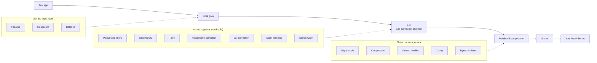

# How the sound is built

[← Back to the README](../README.md)

The decisions behind how Eigentone processes sound, for anyone curious or changing the code.

**On this page:** [The audio chain](#the-audio-chain) · [Presets and global settings](#what-a-preset-holds) · [Changing presets](#changing-presets-smoothly) · [Loudness matching](#loudness-matching) · [The compressor](#one-compressor-shared) · [The graphic EQ](#the-graphic-eq) · [The shape library](#the-shape-library) · [Listening tests](#listening-tests) · [Ear correction](#ear-correction)

## The audio chain

Eigentone uses Android's `DynamicsProcessing` effect on the phone's mixed output, so it shapes every app at once. Every curve, from the preset to your ears, is added together into one EQ, which is the combined curve the Equaliser tab draws.

Virtual surround and reverb are separate Android effects alongside this chain. Why they work the way they do is in [Known limits](KNOWN-LIMITS.md).

## What a preset holds

| Saved with each preset | Global, across presets |
|---|---|
| Parametric filters | Balance |
| Graphic EQ | Ear correction |
| Tone | Night mode |
| Surround | Volume leveller |
| Compressor | Quiet listening (loudness compensation) |
| Strength and correction amount | Limiter |
| Preamp | |

## Changing presets smoothly

Preset changes morph rather than jump (`data/GainRamp.kt`). Bands and the input level move together in steps of at most 4 dB, so if the old and new sounds are each safe from clipping, so is every step between them. The compressor fades along with it, in level, ratio and crossovers.

Bypass, comparisons and the hearing check still switch at once, because a fair comparison needs an instant switch.

## Loudness matching

Comparisons and Bypass are loudness-matched, so the louder version never wins just for being louder. The match includes an estimate of what the compressor does at a typical music level.

> [!NOTE]
> The match is close rather than exact, because real music varies.

## One compressor, shared

The phone has one compressor, so three features share it, in this order of priority (`data/Dynamics.kt`):

1. **Night mode**, while it's on
2. **The compressor**, set by hand
3. **The volume leveller**

## The graphic EQ

The graphic EQ defines its curve directly from the faders rather than using overlapping bell filters. Bells of every width measured strayed by up to 3.3 dB between faders. This works because the audio engine takes a curve sampled on 128 bands.

## The shape library

The **shape library** (`dsp/ShapeLibrary.kt`, `dsp/ShapeData.kt`) has 350 graphic EQ curves.

| Kind | Count | Where they come from |
|---|---:|---|
| Research | 13 | Worked out from published data, and they say so |
| Hand-written | 245 | Problems, music, instruments, speech and media, situations, gear and character |
| Building blocks | 92 | Generated, for layering |

They can be searched and filtered by category, or by traits calculated from each curve.

- Shapes with a source come from published data. The rest are designed starting points, not measurements, and they don't reproduce any artist's or manufacturer's sound.
- Shapes less than a useful difference apart were merged, and their names still find them in search.
- Genre shapes stay within 4 dB, because listening tests found preferences move only about 1 dB between genres, and the genre presets in Android and VLC disagree with each other.

## Listening tests

**Find my sound** narrows bass, vocals, treble and space through level-matched A/B choices. Its ranges follow Harman's published headphone preference research. It finds a preference for this music and these headphones, not an objectively best sound.

The **hearing check** finds a threshold per frequency and ear with a "down 10, up 5" method, capped at -15 dBFS. Levels are relative to the phone's volume, so only the differences between them are used, and the curve corrects half of those.

## Ear correction

Ear correction uses the hearing check's results, which are always drawn as a curve for each ear.

| Question | Answer |
|---|---|
| **When is it recommended?** | When the ears differ by 10 dB or more at any frequency, because the check moves in 5 dB steps. It's available below that as a choice. |
| **What does it do?** | Adds a separate curve to each audio channel that closes half of the gap. |
| **Why one input level for both ears?** | Separate levels would shift the balance across every frequency. |
| **Does it follow presets?** | It stays on across presets. A check also measures the headphones, so each output keeps its own correction and latest results, and it turns on when that output connects. |
| **The phone speaker?** | Never gets one, because it can't reach each ear separately. |
